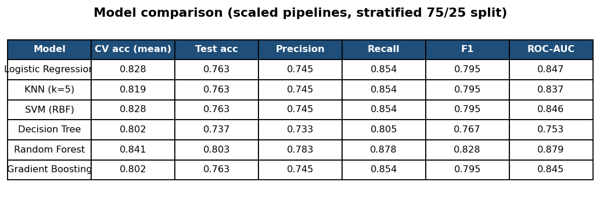
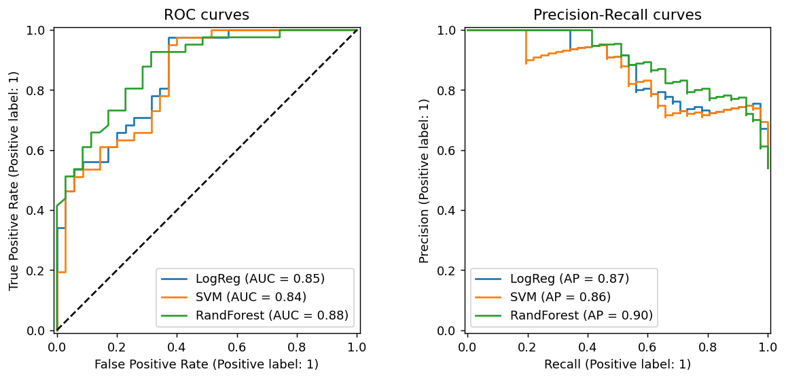
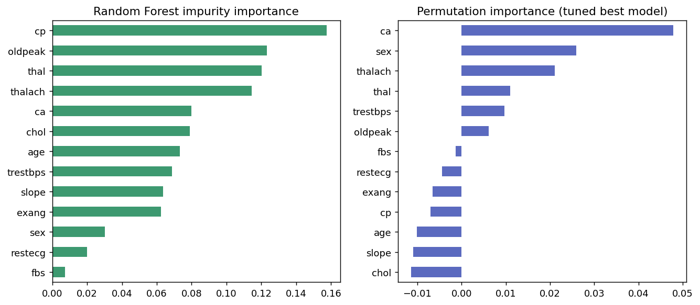

# Cardiac Risk Classifier - Six Scaled ML Pipelines Compared

College Machine Learning mini project (NMIET, Computer Science and Engineering).
Predicts whether a patient has heart disease from 13 clinical attributes and compares six
classifiers fairly, using standardisation inside Scikit-learn pipelines and stratified cross-validation.

Extends the idea of [SaketMunda/heart-disease-ml-project](https://github.com/SaketMunda/heart-disease-ml-project)
(three models, one random split) with scaled pipelines, six models, SVM/Logistic Regression tuning,
precision-recall and threshold analysis, and two feature-importance methods.

## Dataset
Cleveland subset of the [UCI Heart Disease data set](https://archive.ics.uci.edu/ml/datasets/heart+disease):
303 patients, 13 features, target `1` = heart disease (165) / `0` = healthy (138), no missing values.
File: `data/heart-disease.csv`.

| Feature | Meaning |
|---|---|
| age, sex | age in years; 1 = male |
| cp | chest-pain type (0-3) |
| trestbps, chol | resting blood pressure, serum cholesterol |
| fbs, restecg | fasting blood sugar > 120, resting ECG result |
| thalach, exang | max heart rate, exercise-induced angina |
| oldpeak, slope | ST depression, slope of peak exercise ST segment |
| ca, thal | major vessels coloured (0-3), thalassemia status |

## Method
1. Stratified 75/25 split (227 train / 76 test, `random_state=42`).
2. Six pipelines `StandardScaler -> model`: Logistic Regression, KNN, SVM (RBF), Decision Tree, Random Forest, Gradient Boosting.
3. 5-fold stratified CV on the training set + hold-out test metrics (accuracy, precision, recall, F1, ROC-AUC).
4. `GridSearchCV` for SVM (`C`, `gamma`) and Logistic Regression (`C`).
5. Confusion matrices, ROC and precision-recall curves, decision-threshold sweep.
6. Random Forest impurity importance and permutation importance.

## Run
```bash
pip install -r requirements.txt
python src/heart_risk.py            # writes figures, model_comparison.csv and results.json to results/
```

## Results (seed 42)
| Model | CV acc | Test acc | Precision | Recall | F1 | ROC-AUC |
|---|---|---|---|---|---|---|
| Logistic Regression | 0.828 | 0.763 | 0.745 | 0.854 | 0.795 | 0.847 |
| KNN (k=5) | 0.819 | 0.763 | 0.745 | 0.854 | 0.795 | 0.837 |
| SVM (RBF) | 0.828 | 0.763 | 0.745 | 0.854 | 0.795 | 0.846 |
| Decision Tree | 0.802 | 0.737 | 0.733 | 0.805 | 0.767 | 0.753 |
| Random Forest | 0.841 | 0.803 | 0.783 | 0.878 | 0.828 | 0.879 |
| Gradient Boosting | 0.802 | 0.763 | 0.745 | 0.854 | 0.795 | 0.845 |

Tuned RBF-SVM (`C=1, gamma=0.01`): 84.2 % CV accuracy, 76.3 % test accuracy, recall 87.8 %.
The 76-patient test set moves 1.3 points per patient, so prefer the cross-validated numbers.





## Limitations
Only 303 patients from one source, no external validation, no probability calibration.
Academic prototype - not a medical device.
